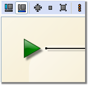

# DiagramEdit

This control is used for editing diagrams such as workflows or surveys.



## Properties

**backColor - string** Background color (btnshadow, white).

**border - string** Changes the control outline style (solid, double, inset, outset, none).

**label - string** Associated label.

**nolabel - boolean** Displays the label as a help bubble.

**readOnly - boolean** Forces the control to read only.

## Remarks

The toolbar can be personalized, each sub-element of this control matches additional buttons in the toolbar.

```xml
<input type="diagramEdit" xpath=".">
  <input type="separator"/>
  <input img="xtk:properties.png" label="Properties" resetForm="true" prebuildSubForm="true">
    <form name="properties" label="Properties">
      <input xpath="/tmp/@test"/>
    </form>
  </input>
  <input type="separator"/>
  <input img="nms:prepare.png" label="Publish" checkModify="true">
    <form name="properties" label="Properties">
      <input xpath="/tmp/@test"/>
    </form>
  </input>
</input>
```

For more information on the buttons in the toolbar, refer to the SubFormButton control documentation.
