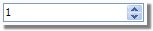

# Number

This control enables you to enter a number.

## Properties

**backColor - string** Background color (btnshadow, white).

**border - string** Changes the border style during control (solid, double, inset, outset, none).

**digitCount - integer** Number of figures to display after the comma. The default value is 2.

**font-size - integer** Changes the font size.

**label - string** Associated label.

**nolabel - boolean** Hides the associated label.

**readOnly - boolean** Forces the control to read only.

**required - boolean** The field is mandatory.

**width - integer** Number of characters to display. The default value is 18 and coincides with 000 000 000 000.00.
