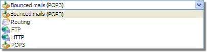

# SysEnum

This control lets you choose a value from a system enumeration.

## Properties

**backColor - string** Background color (btnshadow, white).

**border - string** Changes the control outline style (solid, double, inset, outset, none).

**defaultIfInvalid - string** Value to be used if the value is invalid.

**enum - string** Enumeration to be used.

**font-size - integer** Changes the font size.

**label - string** Associated label.

**noInvalidErr - boolean** Does not display an error if the value is invalid.

**nolabel - boolean** Hides the associated label.

**readOnly - boolean** Forces the control to read only.

**required - boolean** The field is mandatory.

**serialize - boolean** Saves the last value selected.

**useDesc - boolean** Displays the description rather than the label.

**xpathEnum - xpath** Uses the value referenced by this XPath rather than the enum property for the enumeration.
