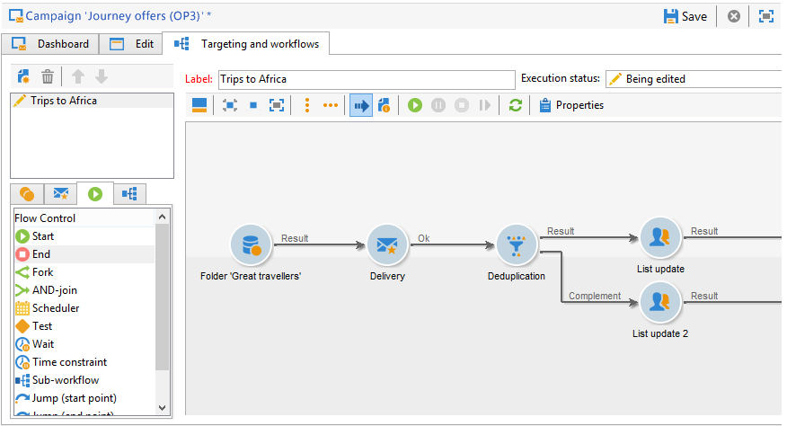

# Offers on an outbound channel{#offers-on-an-outbound-channel}

 

## Email offer delivery {#email-offer-delivery}

In our database, there is a category of travel offers to Africa. The eligibility, contexts and representations of each offer have been configured. We now want to create a campaign to present our offers via email.

1. Create a marketing campaign and a targeting workflow.

   

1. Edit the email delivery and click the **[!UICONTROL Offers]** icon.

   

1. Choose the email space for your offer environment that matches the holidays.

   

1. Choose the category which contains the Africa travel offers.

   

1. Set the number of offers in the delivery to two.

   

1. Close the offer management window and create the content of your delivery. 

   

1. Use the menus to insert a first offer proposition and choose the HTML rendering function.

   

1. Insert the second offer proposition.

   

1. Click **[!UICONTROL Preview]** to preview your offers in the delivery then select a recipient to preview the offers as they will receive them.

   

1. Save your delivery and start the targeting workflow.
1. Open your delivery and click the **[!UICONTROL Audit]** tab of your delivery: you can see that the offer engine has selected the propositions to be made from the various offers in the catalog.

   

## Perform an offer simulation {#perform-an-offer-simulation}

1. In the **[!UICONTROL Profiles and Targets]** tab, click the **[!UICONTROL Simulations]** link, then click the **[!UICONTROL Create]** button.

   

1. Choose a label and specify the execution settings if necessary. 

   

1. Save the simulation. This then opens in a new tab.

   

1. Click the **[!UICONTROL Edit]** tab, then **[!UICONTROL Scope]**.

   

1. Choose the category for which you want to simulate offers.

   

1. Choose the offer space to be used for the simulation.

   

1. Enter validity dates. You must at least enter a start date. This lets the offer engine filter offers and choose those which are valid on a given date. 
1. If necessary, specify one or several themes to restrict the number of offers to those which contain this keyword in their settings.

   In our example, the **Travel** category contains two sub-categories with two separate themes. We want to run a simulation for offers with the **Customers>1 year** theme.

   

1. Choose the recipients you want to target.

   

1. Configure the number of offers to be sent to each recipient.

   In our example, the offer engine will choose the 3 offers with the highest weight for each recipient.

   

1. Save your settings, then click **[!UICONTROL Start]** in the **[!UICONTROL Dashboard]** tab to run the simulation.

   

1. Once the simulation is finished, consult the **[!UICONTROL Results]** for a detailed breakdown of propositions per offer.

   In our example, the offer engine has based the offer breakdown on 3 propositions. 

   

1. Display the **[!UICONTROL Breakdown of offers by rank]** to view the list of offers selected by the offer engine.

   

1. If necessary, you can change the scope settings and run the simulation again by clicking **[!UICONTROL Start simulation]**.

   

1. To save the simulation data, use the history or export functions available in the report. 

   
