# Use cubes to explore data{#use-cubes-to-create-reports}

Use cubes to create reports, and to identify and select data from the database. You can:

* Create reports based on cubes. [Learn more](#explore-the-data-in-a-report).
* Collect the data in the database and group it into lists, for instance to identify and build targets and deliveries. [Learn more](#build-a-target-population).
* Insert a pivot table into a report, reference an existing cube in it. [Learn more](#insert-a-pivot-table-into-a-report).

## Explore the data in a report {#explore-the-data-in-a-report}

### Step 1 - Create a report based on a cube {#step-1---create-a-report-based-on-a-cube}

Once the [cube is configured](cube-indicators.md), it can be used as a template for creating a new report.

To create a report based on an existing cube, follow the steps below:

1. Click the **[!UICONTROL Create]** button of the **[!UICONTROL Reports]** tab and select the cube you have just created.

   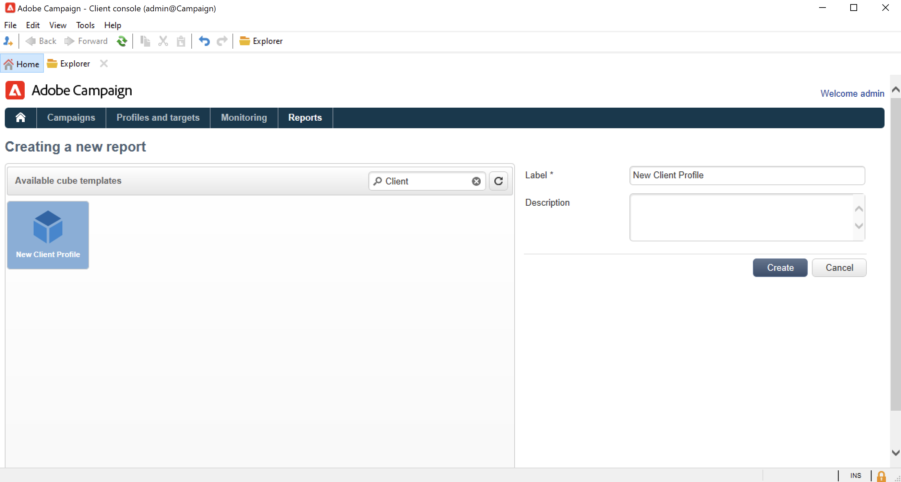

1. Click the **[!UICONTROL Create]** button to confirm: this will take you to the report configuration and viewing page.

   By default, the first two available dimensions are offered in lines and columns but no value is displayed in the table. To generate the table, click the main icon:

   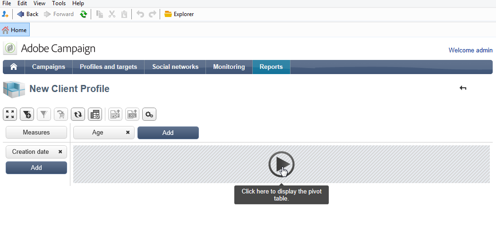

1. You can switch the axes of the dimension, delete them, add new measures, etc. To do this, use the appropriate icons.

   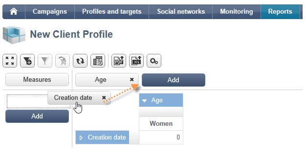

   These operations are detailed below.

### Step 2 - Select lines and columns {#step-2---select-lines-and-columns}

The default display shows the first two dimensions of the cube (age and city, in this case).

The **[!UICONTROL Add]** buttons on each axis enable you to add dimensions. 

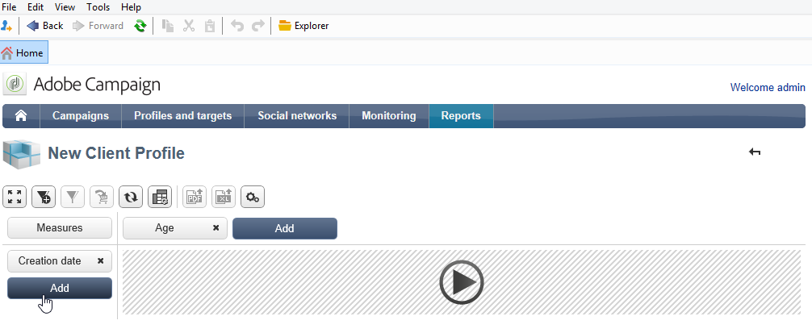

1. Select the dimensions to display in the lines and columns of the table. To do this, drag and drop the available dimensions.
1. Select the dimensions that you want to add to the table from the list:
   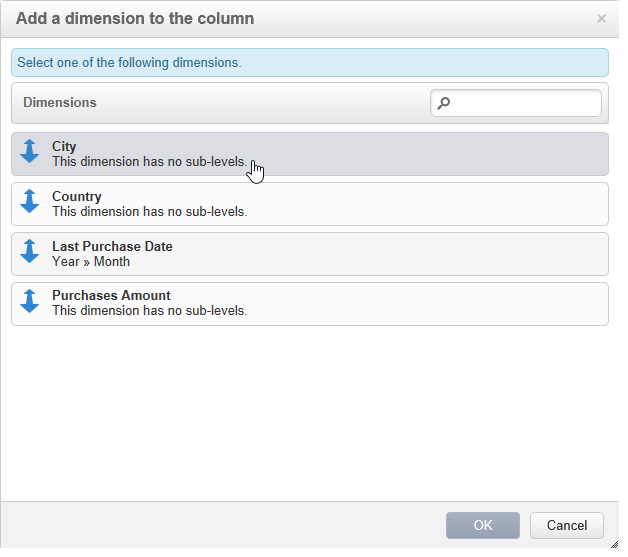

1. Then select the parameters of this dimension. 

   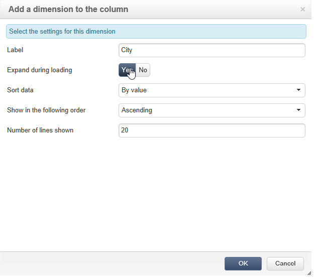

   These parameters depend on the data type of the selected dimension.

   For instance, for dates, several levels can be available. For more on this, refer to [Display measures](customize-cubes.md#display-measures).

   In that case, the following options are available:

   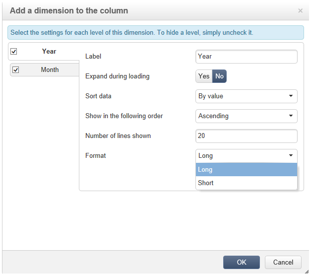

   You can either:

    * Expand data during loading: the values will be displayed by default each time the report is updated (default value: no).
    * Display the total at the end of the line: when the data is displayed in columns, an additional option lets you display the total at the end of the line: a column is added to the table (default value: yes).
    * Apply a sort: the values of the column can be sorted according to value, label, or based on a measure (default value: by value).
    * Display the values in ascending (a-z, 0-9) or descending (z-a, 9-0) order.
    * Change the number of columns to be displayed upon loading (by default: 200).

1. Click **[!UICONTROL Ok]** to confirm: the dimension is added to the existing dimensions.

   The yellow banner above the table shows that you have made changes: click the **[!UICONTROL Save]** button to save them.

   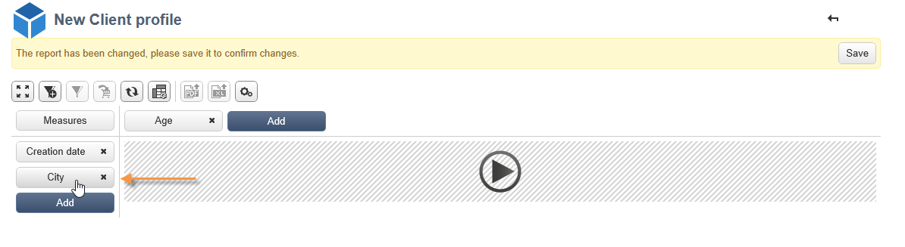

### Step 3 - Configure the measures to display {#step-3---configure-the-measures-to-display}

Once the lines and columns are defined, select which measures you want to display. By default, only one measure is displayed. 

To add and configure measures, follow the steps below:

1. Click the **[!UICONTROL Measures]** button. 

   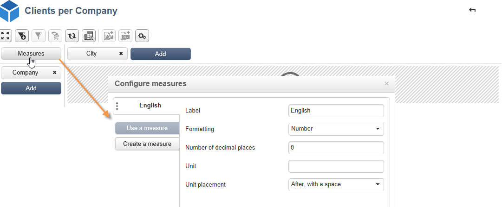

1. With the **[!UICONTROL Use a measure]** button, select one of the existing measures.

   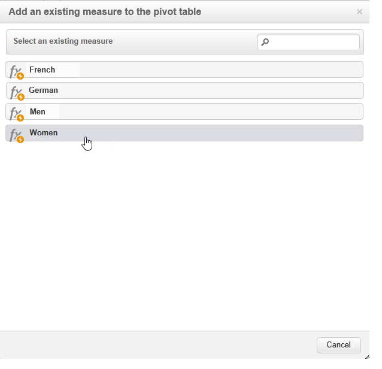

   Choose the information to display and the formatting options. The list of options depends on the type of measure.

   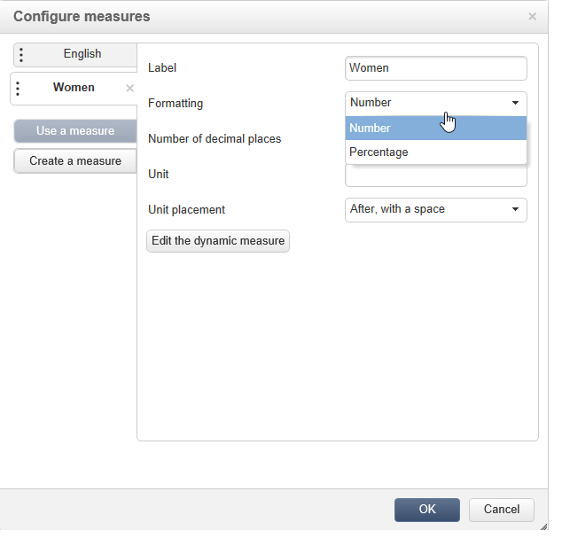

   Overall measure configuration is also available via the **[!UICONTROL Edit the configuration of the pivot table]** icon in the header.

   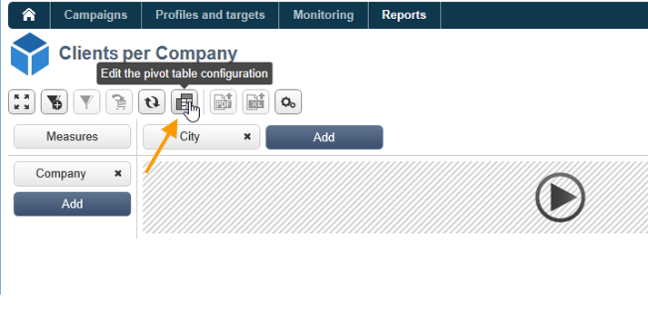

   You can then choose whether or not to display measure labels. [Learn more](customize-cubes.md#configuring-the-display).

1. You can build new measures based on existing ones. To do this, click **[!UICONTROL Create a measure]** and configure it.

   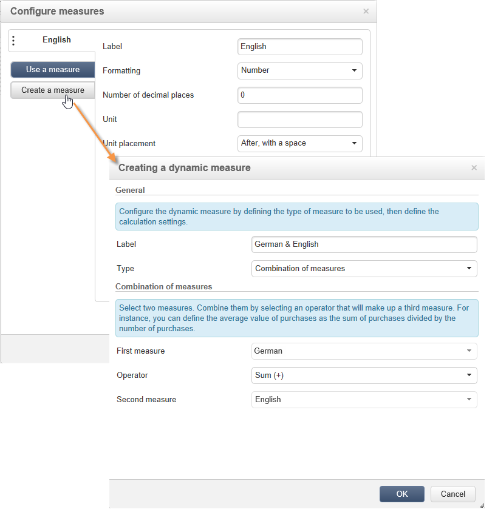

   The following types of measures are available:

    * Combination of measures: this type of measure enables you to build the new measure using existing ones:

      The available operators are: sum, difference, multiplication and rate.
    
    * Proportion: this type of measure enables you to calculate the number of records measured for a given dimension. You can calculate the proportionality based on a dimension or sub-dimension.
    * Variation: this measure lets you calculate the variation in values of a level.
    * Standard deviation: this type of measure lets you calculate deviations within each group of cells compared to the average of the values. For instance, you could compare the purchase volume for all existing segments.

   Once created, the measure is added to the report.

   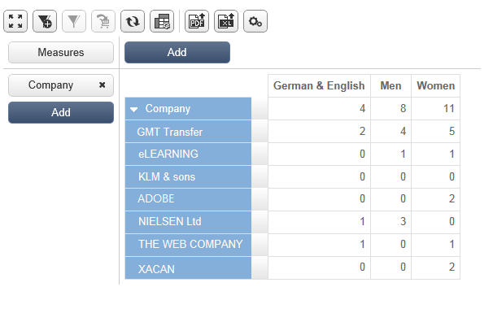

   Once you have created a measure, you can edit it and change its configuration. To do this, click the **[!UICONTROL Measures]** button, then browse to the tab of the measure to edit.

   Then click **[!UICONTROL Edit the dynamic measure]** to access the settings menu.

## Build a target population {#build-a-target-population}

Reports built using cubes enable you to collect data from the table and save it in a list.

To group a population into a list, follow the steps below:

1. Click the cells that contain the population to be collected to select them, then click the **[!UICONTROL Add to cart]** icon.

   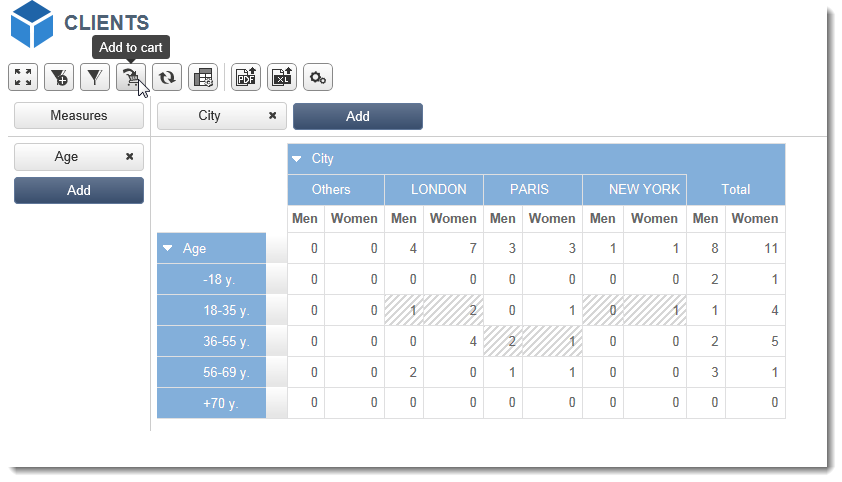

   Do this as many times as necessary to collect various profiles.

1. Click the **[!UICONTROL Show cart]** button to view its content before running the export.

   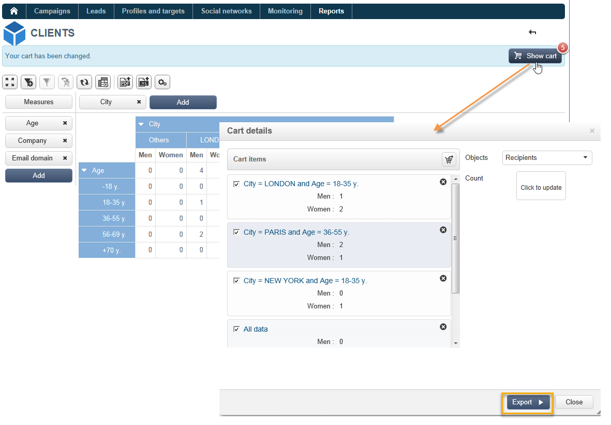

1. Use the **[!UICONTROL Export]** button to group the items in the cart into a list.

   Enter the name of the list and select the type of export to carry out.

   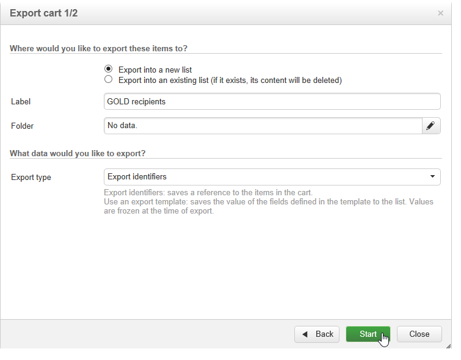

   Click **[!UICONTROL Start]** to run the export.

1. Once the export is complete, a message confirms its execution and the number of records that have been processed.

   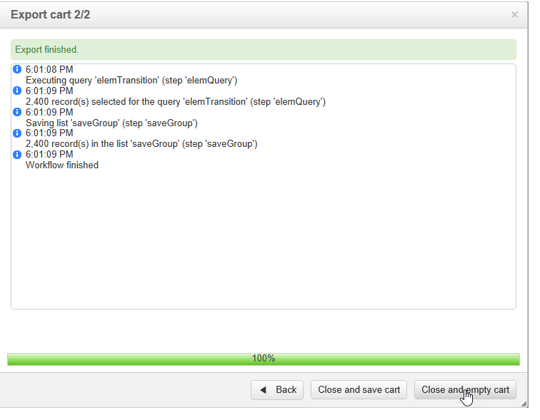

   You can either save the content of the cart or empty it.

   The new list is available via the **[!UICONTROL Profiles and targets]** tab.

   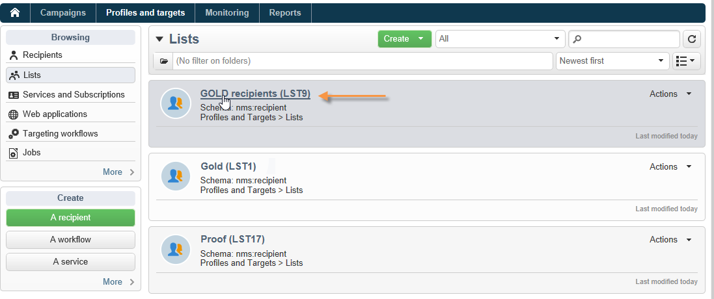

## Insert a pivot table into a report {#insert-a-pivot-table-into-a-report}

To create a table and explore the data in a cube, follow the steps below:

1. Create a new report with a single page and insert a pivot table into it. 

   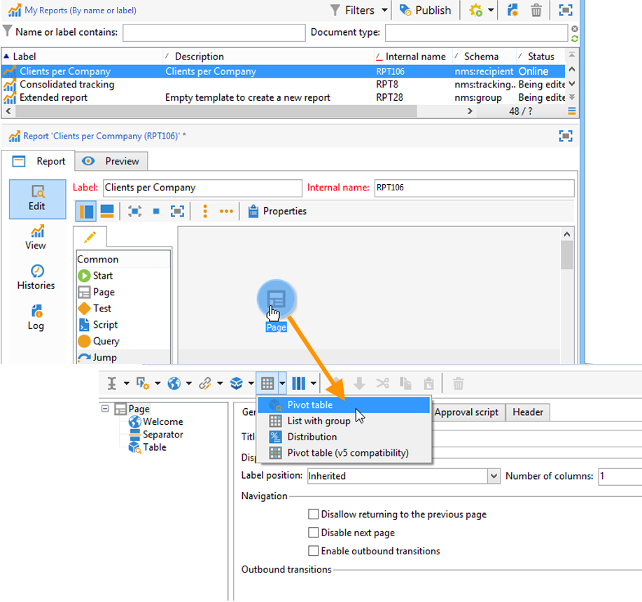

1. In the **[!UICONTROL Data]** tab of the page, select a cube to process the dimensions it contains and display calculated measures.

   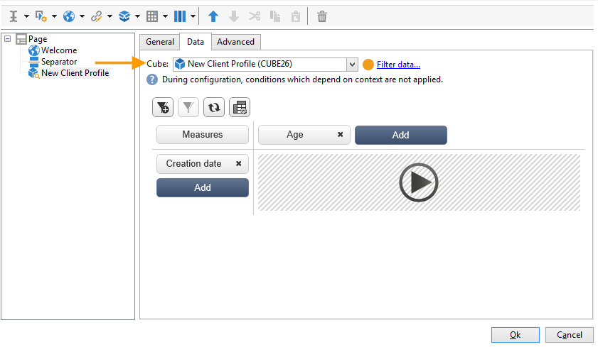

   This lets you build the report to be displayed. For more on this, refer to [Step 2 - Select lines and columns](#step-2---select-lines-and-columns).
